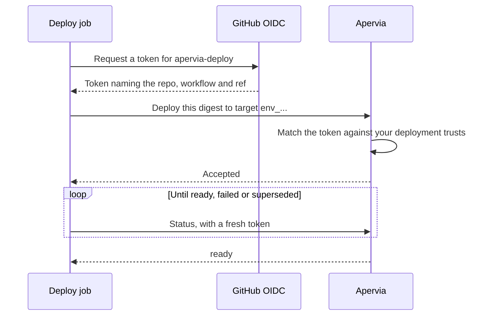

<div align="center">
  
  <h1><code>apervia-deploy-action</code></h1>
  <p><strong>The Apervia Deploy Action</strong></p>
  <p>Deploy a container image to an Apervia environment<br />from GitHub Actions, with no API key to store.</p>
  <p>
    <a href="#usage">Usage</a> ·
    <a href="#how-it-works">How it works</a> ·
    <a href="#versions">Versions</a> ·
    <a href="CONTRIBUTING.md">Contributing</a>
  </p>
</div>

## Usage

Add the action to a deploy job:

```yaml
jobs:
  deploy:
    runs-on: ubuntu-latest
    permissions:
      id-token: write
    steps:
      - uses: apervia/apervia-deploy-action@v4
        with:
          target: env_abcdefghijklmnopqrst
          image: ghcr.io/acme/widget@sha256:<digest>
```

The action deploys an image that your workflow has already built and pushed. It
takes a digest, not a tag, so what you tested is what runs. A private image
needs a registry credential in your Apervia console.

### A full workflow

Your Apervia console generates a workflow like this one. Save it under the file
name the console gives you, because a deployment trust names one workflow file.

```yaml
name: Deploy to Apervia

on:
  push:
    branches: [main]

permissions: {}

jobs:
  build:
    runs-on: ubuntu-latest
    permissions:
      contents: read
      packages: write
    outputs:
      digest: ${{ steps.build.outputs.digest }}
    steps:
      - uses: actions/checkout@v7
      - uses: docker/login-action@v4
        with:
          registry: ghcr.io
          username: ${{ github.actor }}
          password: ${{ secrets.GITHUB_TOKEN }}
      - id: build
        uses: docker/build-push-action@v7
        with:
          context: .
          push: true
          tags: ghcr.io/acme/widget:${{ github.sha }}

  deploy:
    needs: build
    runs-on: ubuntu-latest
    environment: production # the GitHub environment, for required reviewers
    permissions:
      id-token: write
    steps:
      - uses: apervia/apervia-deploy-action@v4
        with:
          target: env_abcdefghijklmnopqrst # the Apervia environment
          image: ghcr.io/acme/widget@${{ needs.build.outputs.digest }}
```

## Inputs

| Required | Description |
| --- | --- |
| `target` | The Apervia environment, as the workflow in your Apervia console names it. It never changes. This is not the GitHub `environment` of the job. |
| `image` | A repository and a digest, for example `ghcr.io/acme/widget@sha256:...`. |

| Optional | Default | Description |
| --- | --- | --- |
| `platform-url` | `https://deploy.apervia.ai` | The deployment origin. Leave it unset unless your Apervia console's workflow sets it. |
| `poll-interval` | `5` | Seconds between status checks, from 1 to 60. |
| `timeout` | `600` | Seconds to wait for the release, from 30 to 3600. |
| `auto-deploy` | `true` | Set it to `false` to hold the new version until a person releases it in the Apervia console. The job then ends with the state `waiting`. The first deploy into an environment is never held. |

## Outputs

| Name | Description |
| --- | --- |
| `release` | The release number. |
| `digest` | The digest that was deployed. |
| `state` | `ready`, `failed`, `superseded` or `waiting`. The action fails unless it is `ready`, or `waiting` after `auto-deploy: false`. |

## How it works



A deployment trust in your Apervia console lists what may deploy to an
environment: the repository, the workflow file, the branches or GitHub
environments, and the image repository. Apervia refuses any other run with a
`403`.

- **Require approval for production.** Give the deploy job a GitHub environment
  with required reviewers, and select that environment in the trust.
- **Review each version in Apervia.** Set `auto-deploy: false`. The job ends
  when Apervia has the new version, and a person puts it live from the
  environment's Overview page.
- **Keep `id-token: write` on the deploy job only.** Any step in a job with that
  permission can deploy.

The [wire contract](docs/wire-contract.md) defines the requests and responses.

### From v3 to v4

v3 named the environment by the `application` and `environment` slugs. A slug
changes when somebody changes the application's address in Apervia, and the
workflow then stops deploying with a `403`. v4 names it by `target`, which
never changes.

To move, copy the workflow from the environment in the Apervia console, or
replace the two inputs with `target` and change `@v3` to `@v4`. v4 still accepts
`application` and `environment`, so a workflow that you move to `@v4` without
other changes keeps working.

## Versions

Use the newest release, for example `@v4`. Each new release gets the next
number, and Dependabot or Renovate offers you the upgrade.

## Contributing

See [CONTRIBUTING.md](CONTRIBUTING.md).

## License

MIT. See [LICENSE](LICENSE).
